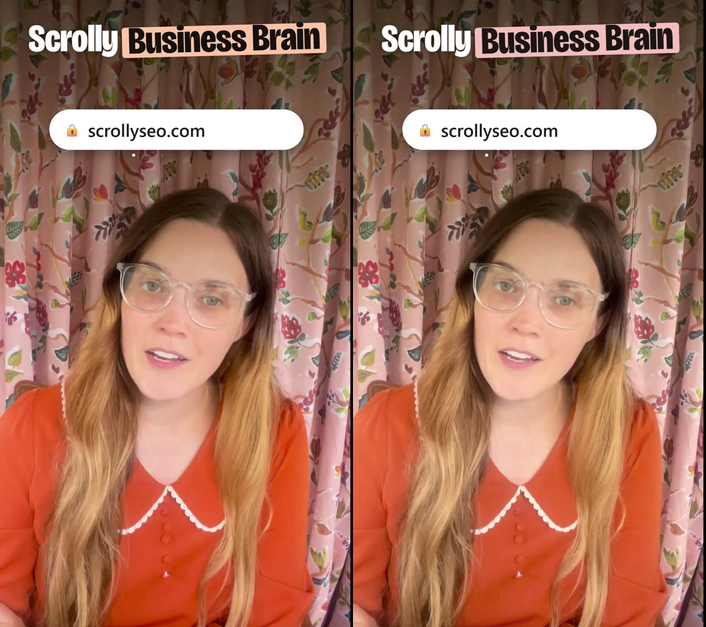
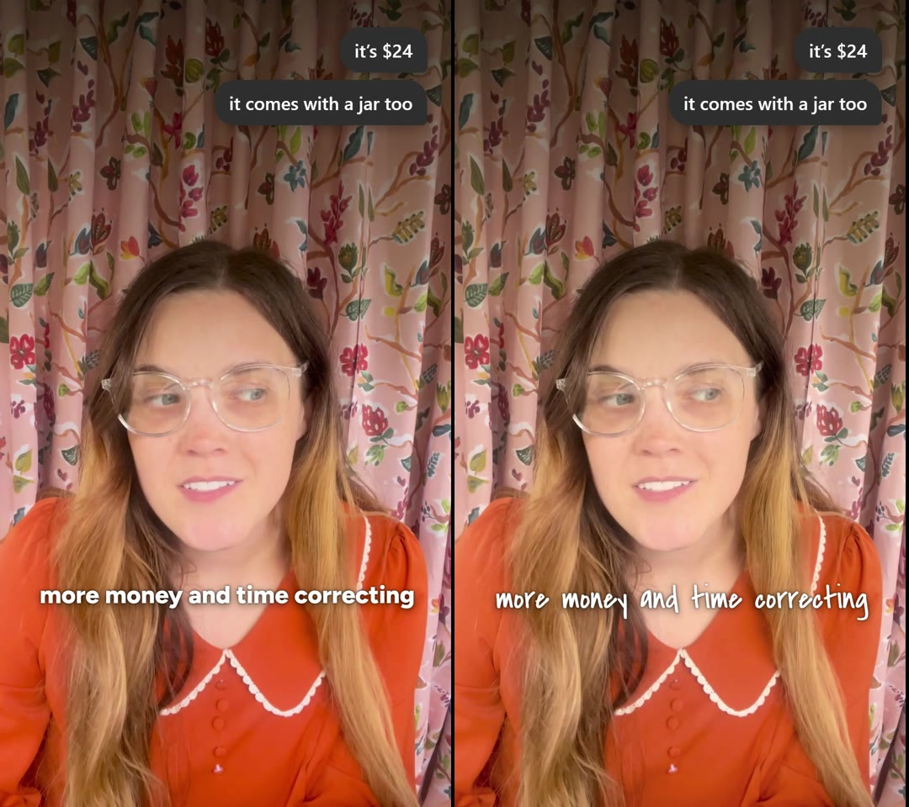
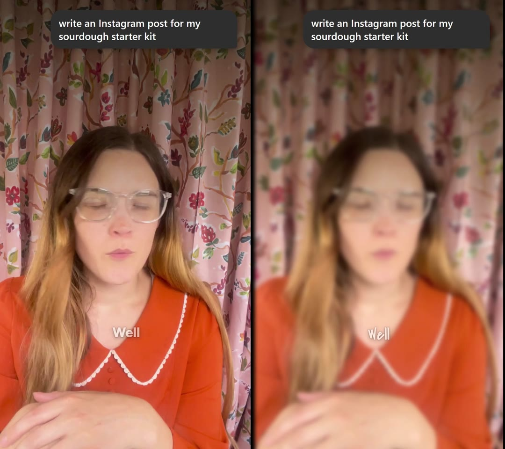
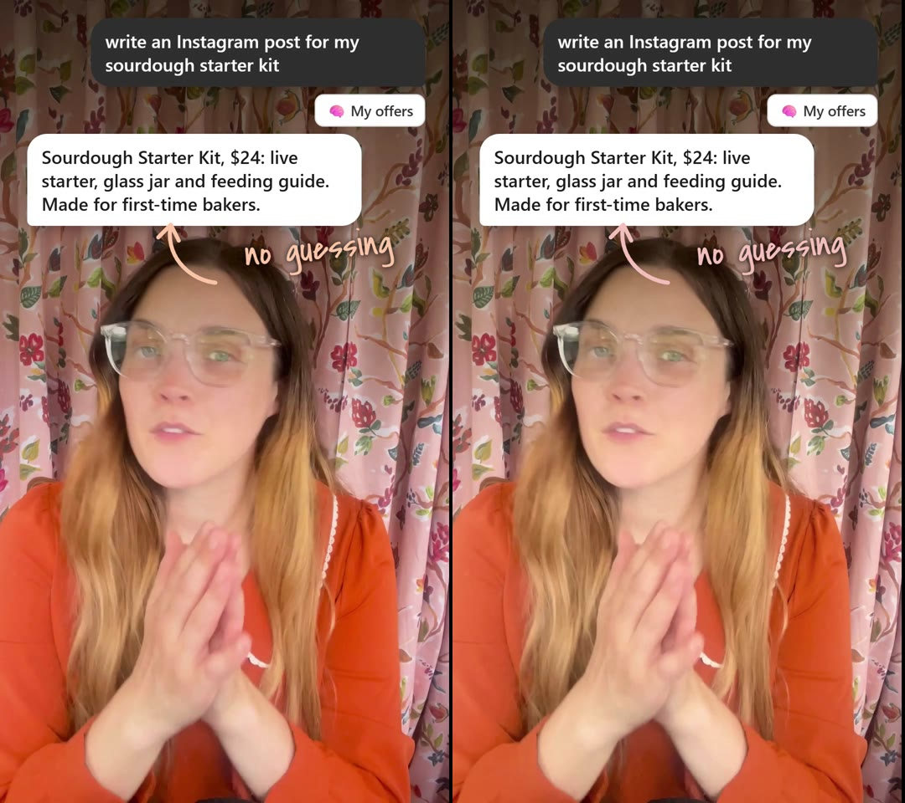
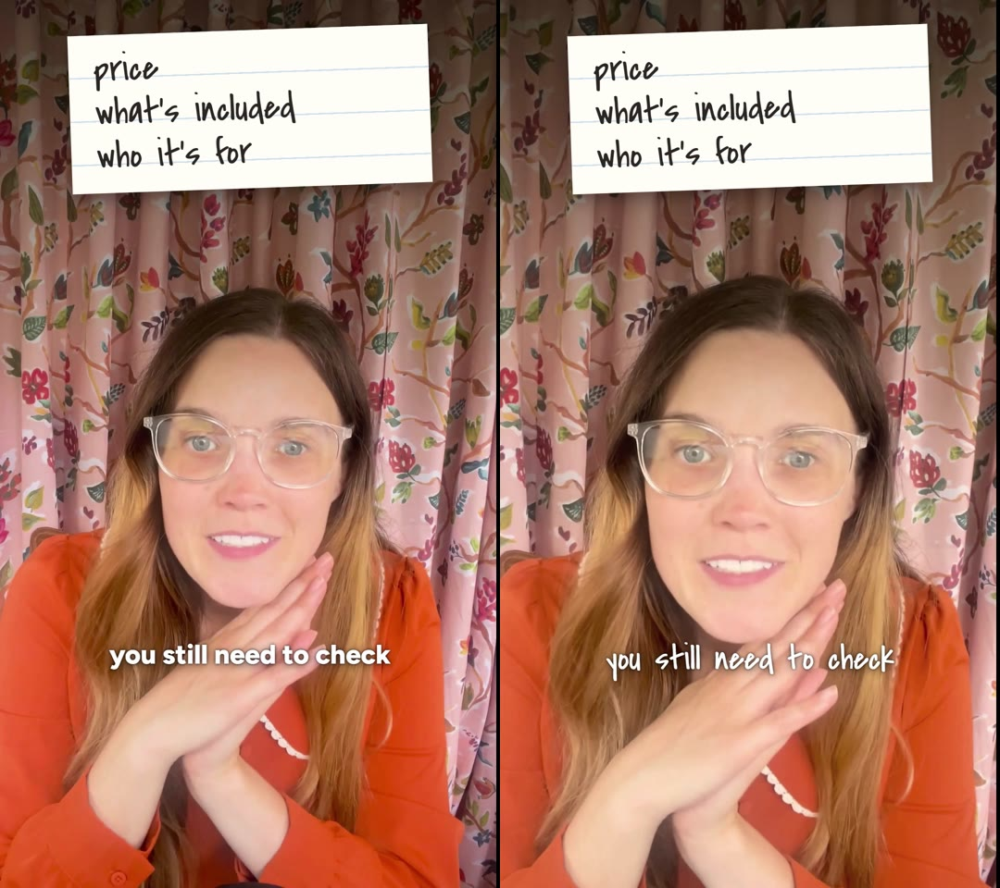
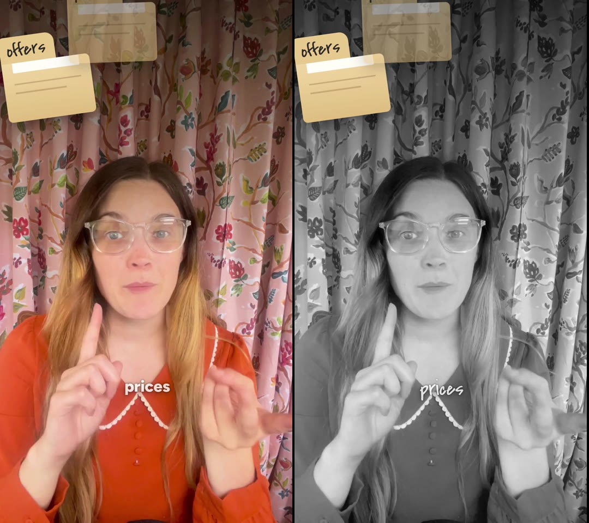

# Reel engine test: the render honors every review-page choice (2026-10-13)

Follows the Session 4 proof in `reel-engine-handoff.md`, which covered the look filter, one zoom and one sound swap but
not captions or the brand kit. This test covers every choice type the page saves.

## Setup
- A COPY of Reel #2 (`automation/reel-hf/_e2e-page-choices/`, git-ignored, no renders or review files copied). The
  posted Reel's folder, its `review/decisions.json` and the OneDrive exports were not touched.
- `REEL_DECISIONS=review/test-decisions.json node build.mjs` with these choices:

```json
{ "brand": "scrolly-holiday",
  "captions": { "32": { "style": "big", "mark": [2] } },  "captionFont": "hand",
  "sound": { "fx-pop2a": { "name": "chime" } },
  "addedSfx": [ { "id": "add-test1", "name": "buzzer", "t": 47.2, "vol": 0.6 } ],
  "transitions": { "F3": "whip", "F8": "zoom" },
  "look": { "warmth": 0.45, "saturate": 1.05 },
  "lookByFrame": { "6": { "saturate": 0, "contrast": 1.08 } } }
```
- `buzzer.mp3` was deleted from the copy's `assets/sfx` first, to prove an added sound is copied in from `lib/`.
- `npm run check` passed. Full render: 61.2 s, 1080x1920, 9 min 6 s.

## Results (left = posted render, right = test render)
| Choice | Result | Frame |
|---|---|---|
| Brand kit: Scrolly Holiday | Pass: marker swipes use the Holiday peach, the F5 panel uses the Holiday mist (green-grey instead of blue-grey). No Scrolly hex codes left in index.html |    |
| Caption font: handwritten | Pass: every caption is in Covered By Your Grace |  |
| Big caption + marker word (#32 "instead of guessing", marker on "guessing") | Pass: big Bricolage line, "guessing" in ink on the peach marker |  |
| Swapped sound (F2 pop → chime, 4.66 s) | Pass (matched-filter score, 0 to 1): chime 0.56 in test vs 0.05 posted; the old pop drops from 0.45 to 0.13 | audio |
| Added sound (buzzer at 47.2 s) | Pass: buzzer 0.54 in test vs 0.03 posted (control at 20 s: 0.05 both) | audio |
| Whip into F3 (10.8 s) | Pass: full motion blur at 10.83 s (edge detail 0.03 vs 3.56 posted) |   |
| Zoom into F8 (45.98 s) | Pass: framing pushes in to 1.15 by 46.6 s |   |
| Whole-Reel filter: Warm | Pass but subtle: frames ~3% brighter, slightly warmer (the Warm preset is mild by design) | see 04 |
| One moment's own filter: F6 black and white | Pass: F6 colour saturation 0 (posted: 39); F5 and F7 keep the Warm look |  |

## Engine bugs found and fixed (`automation/reel-hf/lib`)
1. **Template chime length was longer than the file** (`templates/studio.mjs`: 1.6 s listed, ~1.26 s real). Any
   swapped or added chime got a slot past its end (`npm run check` warned). Now 1.25 s.
2. **Caption fade-in also grabbed the marker's inner spans** (`reel.mjs`): `.cap span` matched the nested marker spans,
   whose parent has no start time, so they got a NaN start (GSAP turns it into 0 s). It looked fine, but by luck. When a
   caption has a marker word the selector is now `.cap > span`. Reels without marker words get the exact same output.

Identity check: `2026-10-13-bb-voice-file/build-lib.mjs` output is byte-identical before and after the fixes. Reel #2
built from the copy with no choices is also identical to its posted `index.html`.

## Notes (not fixed)
- The one contrast flag in `npm run check` (2.49:1 at 44.16 s) is on the marked caption. The checker compares the white
  words with the peach marker box in the same line. The marked word itself is ink on peach. Treat it as a false alarm
  on marker captions.
- Whips don't blur her cut-out moments (F5, F9). The cut-out video sits outside the camera layer. This is how the
  approved Reels already work.
- `2026-10-13-bb-voice-file/index.html` (committed) is behind the library on placeholder CSS (`.ph`, `.ph-ring` changed
  for Reel #2). That Reel is posted, so it was left alone. Its `build-lib.mjs` output now differs from it only there.
- The Holiday kit was not tested on a cover. `render-ready.mjs` already passes her kit to `renderCovers`.
